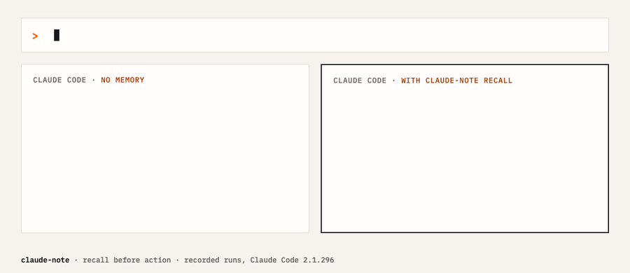
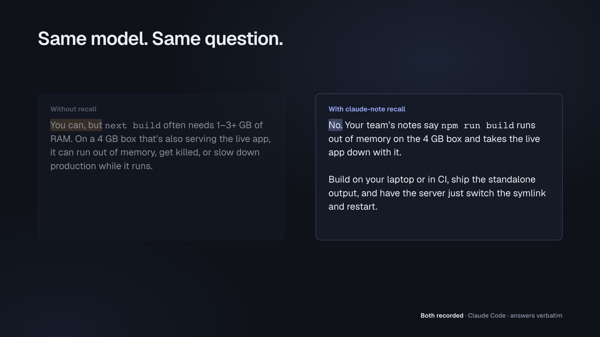

# Claude Note

**Your agents already solved this. Claude Note makes sure they remember.**

Claude Note captures what Claude Code, Codex, Cursor and ChatGPT sessions learn, keeps it as typed
Markdown notes, and puts the right notes in front of the agent *before* it acts: on every prompt,
and again the moment a command fails.

<a id="install"></a>

## Quick install

Requirements: Python 3.11+, [uv](https://docs.astral.sh/uv/), [QMD](https://github.com/tobi/qmd)
for search, and the [Claude CLI](https://code.claude.com/docs/en/overview) for synthesis.

```bash
git clone https://github.com/crimeacs/claude-note.git ~/src/claude-note
cd ~/src/claude-note
scripts/install-from-checkout.sh --non-interactive \
  --vault ~/Documents/notes --author you@example.com --claude-hooks

claude-note setup --codex      # index, recall + sentinel hooks, agent rules, hourly refresh
claude-note doctor             # prove it works
```

[Setup and upgrade details](#setup-and-upgrades).

## Overview

Version 2.1 preserves source evidence, scopes retrieval before truncation, and stages changes
that would replace human edits. Structured claims carry applicability and separate local
attestations; authored approval text never grants authority. See the
[implementation and rollout record](docs/VERIFIED_MEMORY_IMPLEMENTATION.md).

**Upgrade:** external model and staging calls require an explicit source policy. The default
permits local capture and host recall. Configure only the sources you authorize in
[the egress reference](docs/configuration.md#source-egress-policy). Existing notes remain
unverified leads, and staged changes require review. No productivity gain is claimed from
the deterministic regression suite.



*Two recorded runs of Claude Code 2.1.296: same model, same question, one with recall
([raw runs](docs/examples/recall-demo/runs/qmd-query-question.json)).*

How we use it across a company of agents, and how well it works on our own 15,000 notes:
**[Memory Engineering 101: our approach to building a company brain](https://getsweat.ai/blog/claude-note-recall/)**.

[](docs/assets/claude-note-2.mp4)

[Watch the 2½-minute walkthrough](docs/assets/claude-note-2.mp4) · [Captions](docs/assets/claude-note-2.vtt) ·
[How it was filmed](docs/demo.md)

```text
 capture ──▶ notes ──▶ recall ──▶ act ──▶ remember
    ▲                                        │
    └────────────────────────────────────────┘
```

| | What happens | Command |
|---|---|---|
| **Capture** | Hooks queue every session; a background worker extracts decisions, gotchas and patterns into typed notes. | automatic |
| **Recall** | Before the model sees a prompt, a hook searches your notes and injects a short, source-linked shortlist. A miss is announced, never silent. | automatic, or `claude-note recall "…"` |
| **Sentinel** | When a shell command fails, the known fix for that error is surfaced before the agent retries. Auth, quota and disk-full errors are flagged as "do not retry". | automatic |
| **Remember** | Write a lesson immediately; lexical indexing and vector freshness are tracked separately. | `claude-note remember` |
| **Prove it** | Check configuration, isolated hooks, the actual default server and recorded host delivery separately. | `claude-note doctor` |

## What it looks like

A real Claude Code session with recall installed. The agent was never told about the team's build
rule; the hook found the note, the agent opened it, and answered from it:

```text
> We deploy our Next.js app to the 4 GB production server. Can I just run npm run build on the box?

  ⎿ claude-note recall (hook context, abbreviated):
    - Never run the production build on the 4 GB box (decision)  [notes/never-build-on-a-small-box.md]

● No. Your team's notes say `npm run build` runs out of memory on the 4 GB box and takes the live
  app down with it. Build on your laptop or in CI, ship the standalone output, and have the server
  just switch the symlink and restart.
```

Without recall, the same model answered "You can, but…". Codex, with the same hook, answered "No"
and linked the note. Both runs are in [docs/demo.md](docs/demo.md).

## Setup and upgrades

Upgrades retain the installed tool's external Python. Use `--python 3.11` with
the checkout installer, or set `UV_PYTHON=3.11` with either installer, to reselect
through uv's current settings. An explicit executable works too. Persistent uv
discovery preferences do not migrate an existing runtime automatically; see
[the installer policy](docs/developments.md#216--retain-the-installed-python-on-upgrades).

`setup` is idempotent and backs up every file it changes; `--dry-run` shows what it would do. It:

1. registers your vault, and Claude Code's per-project memory files, as QMD collections, so one
   search spans both;
2. adds `claude-note hook recall` (UserPromptSubmit) and `claude-note hook sentinel`
   (PostToolUse / PostToolUseFailure on Bash) next to the capture hooks, for Claude Code and,
   with `--codex`, Codex;
3. adds a short *recall before action* rule to `~/.claude/CLAUDE.md` and `~/.codex/AGENTS.md`, so
   agents also search on purpose when the automatic lookup misses;
4. schedules `claude-note refresh` hourly: text index, then vectors, with a lock, hard timeouts and
   a heartbeat.

Codex runs new hooks only after you trust them: run `codex` once and accept the prompt.

## Everyday use

```bash
claude-note recall "gmail 403 after adding calendar scope"     # what do we already know?
claude-note remember --type gotcha --tags oauth \
  "Adding a Google scope does not upgrade existing tokens: delete the token, re-consent with all scopes"
claude-note remember --type decision --why "the box OOMs" "Build on the laptop, never on the 4 GB server"
claude-note doctor                                              # configured, exercised, in use
claude-note recall --stats                                      # hit rate and latency of the hook
```

Types matter: a failure lesson is a `gotcha`, a reusable method a `pattern`, an accepted choice a
`decision`. The sentinel prefers gotchas when a command fails. If a note with the same title exists,
`remember` appends a dated block instead of overwriting; recall shows the newest block first.

## Measure it

Recall is only useful if it puts the right note in front of the agent. `claude-note eval` measures
that, keeps a history, and draws a dashboard you or your agent can read:

```bash
claude-note eval probes -n 80     # questions written from your own notes (Claude CLI, once)
claude-note eval run              # did recall inject the note each question came from?
claude-note eval live             # real prompts: misses, latency, did the agent open the note?
claude-note eval answers -n 10    # same question with and without recall, judged blind
claude-note eval dashboard        # trends, failing questions, what to fix next
claude-note eval report --json    # the same, for an agent
```

Labels never come from recall itself: a probe's answer is the note it was written from, the bundled
fixture is hand-labelled, and every run is compared with a plain keyword search. Probes are split
into dev and test by note, so a setting tuned on dev is reported on test. After setup, the hourly
refresh re-scores the frozen probes once a day, and `doctor` shows the latest score. Details and
what each number means: [docs/evals.md](docs/evals.md).

An opt-in [captured-experience learning loop and public comparison](experiments/learning_curve/README.md)
also tests whether model-extracted, consolidated lessons help later tasks compared with frozen
memory and growing raw history. Its public study is separate from installed private-data workers.

## Why recall finds things

Keyword search over notes is fast (≈0.3 s) but conjunctive: *"how should I organise obsidian note
types and the graph view"* returns nothing, while *"obsidian note types graph view"* returns seven
notes. Recall was built against that failure on a real 15,000-note index:

- the prompt is reduced to content words: stopwords, imperative verbs, paths, URLs and dates go;
  `task-backed`, `source_unchanged` and `config.toml` are split, because each matched nothing as
  one token;
- it searches the full query and progressively narrower ones (the most specific 5, 3 and 2 words)
  and pools *every* rung; a note several rungs agree on ranks first;
- session transcripts and the inbox are skipped; append-log notes show their newest update;
- hand-written agent memories get reserved slots, because short notes rank low in BM25;
- a failed command is searched by its error identifiers (`insufficientPermissions`, `ENOSPC`,
  `invalid_grant`) one by one, since they are specific on their own;
- every miss is announced with the query that was tried. Silence looks exactly like a hook that
  never ran, and agents read it as "nothing is known".

All of it fails open under a wall-clock budget: recall can never block a prompt. An optional
`rerank_command` can pass the shortlist to your own relevance judge. Details:
[docs/recall.md](docs/recall.md).

## Capture sources

| Source | Capture path |
|---|---|
| Claude Code | `PostToolUse`, `UserPromptSubmit`, `Stop` hooks, plus a recovery sweep of recent sessions. |
| Codex CLI / desktop | Hooks where trusted, plus a rollout recovery sweep. Automation and subagent threads are skipped. |
| Cursor | Reads supported local chat databases, read-only. |
| Claude desktop / web, ChatGPT | Export zips, dropped in the import folder or passed to `claude-note import`. |

The worker synthesizes each finished session with the Claude CLI into typed notes (`route` mode) or
an inbox for review (`inbox` mode). See [synthesis modes](docs/synthesis-modes.md).

`claude-note worker --capture-only` writes local session notes while holding
model work and preserving its retry state. It retains journals and runs recovery
imports in a separate resource-supervised process; see [troubleshooting](docs/troubleshooting.md).

## Configuration

`~/.config/claude-note/config.toml`:

```toml
vault_root = "/Users/you/Documents/notes"
author = "you@example.com"

[synthesis]
mode = "route"                    # log | inbox | route

[recall]
collections = []                  # empty = every QMD collection
memory_collections = ["agentmem"] # reserved slots for agent memories
inject = 4                        # notes per prompt
timeout = 6                       # seconds per search, wall clock
# rerank_command = "my-judge"     # optional: JSON on stdin -> {"keep": ["c0", ...]}

[sentinel]
enabled = true
# [[sentinel.rules]]
# match = "ECONNREFUSED 127.0.0.1:5432"
# advice = "Local Postgres is not running: `brew services start postgresql`."
```

Turn recall off for one shell with `CLAUDE_NOTE_RECALL=off`. Full reference:
[configuration](docs/configuration.md).

## Sharing with a team

`claude-note push` stages curated, redacted notes (`pattern`, `gotcha`, `decision`, `reference`,
`project`, `literature`) to a shared Sweat AI vault inbox, skipping sessions, private folders and
`share: false` notes. `--install-agent` schedules it daily. See [commands](docs/commands.md).

## Operate and develop

```bash
claude-note status --json         # health, works before configuration, exit 1 on problems
claude-note doctor --json         # configured / exercised / in use
claude-note drain                 # process queued sessions now
PYTHONPATH=src python3 -m unittest discover -s tests
```

| Guide | |
|---|---|
| [Recall, sentinel and remember](docs/recall.md) | How the loop's second half works, and what each rule fixed |
| [Evals](docs/evals.md) | Is recall finding the right notes, and how to make it better |
| [Getting started](docs/getting-started.md) | Install and verify the first capture |
| [Commands](docs/commands.md) / [configuration](docs/configuration.md) | Every interface |
| [Hooks](docs/hook-setup.md) / [services](docs/service-setup.md) | What runs where |
| [Architecture](docs/architecture.md) / [current system](docs/current-system.md) | Design and boundaries |
| [Developments](docs/developments.md) | What changed, release by release |

MIT licensed. Original project by [artemiin](https://github.com/artemiin/claude-note).
