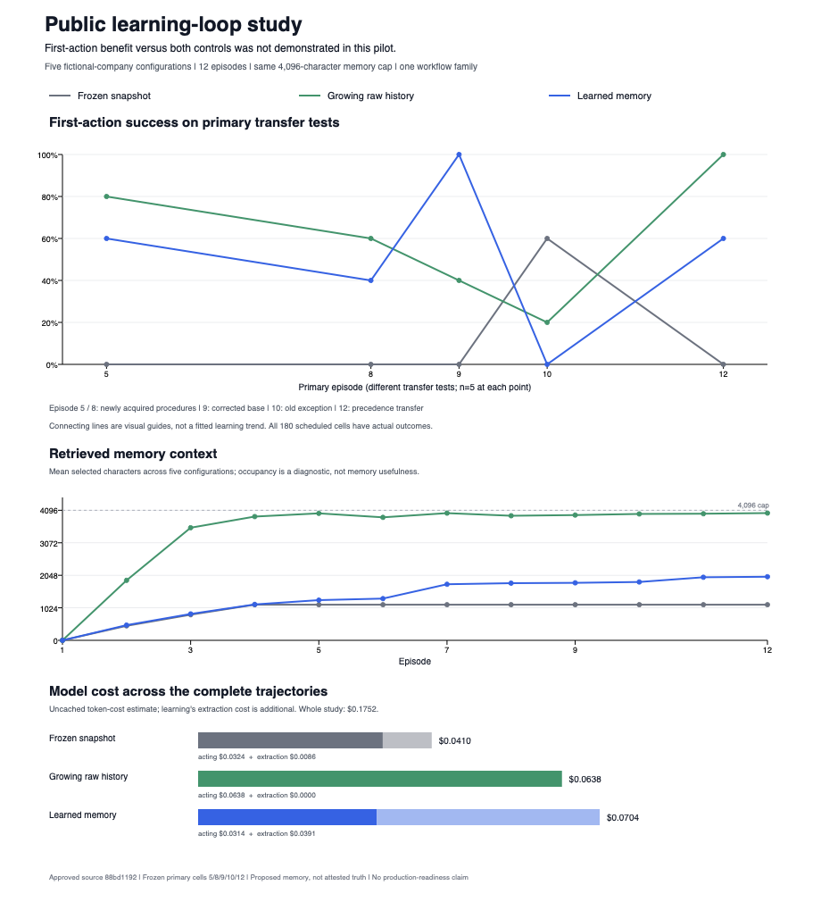

# Claude Note: does accumulated learned memory help?

Study date: 30 October 2026. Frozen implementation and protocol: `88bd1192a315b6b174b5f05cf97b847d4011fdd5`.

**This implementation failed the adoption gate.** It beat its frozen-memory control on first-action transfer, but underperformed growing raw history. Its later exception tasks regressed. No default-memory policy or evaluation baseline is promoted.

[Machine-readable outcomes for all 180 cells](learning-loop-public-study-2026-10-30.json).

The opt-in loop captures actual tasks/actions/operational outcomes, calls a real model to extract proposed lessons, records exact evidence and consolidation ancestry, retains immutable corrections, and retrieves scoped prior lessons before the next task. This experiment uses that loop, not deterministic gold extraction. Installed private-data workers were not changed.

## Actual comparison

Five independently permuted fictional company configurations, twelve episodes each, three arms: 180 completed task cells. All arms use the same pinned `gpt-4.1-mini-2025-04-14` actor, at most two actions and 4096 memory characters. Frozen and learned arms acquire their own first three experiences separately; the learned arm continues updating and the frozen arm stops. The raw arm grows its own journals and uses fixed lexical windows.

The primary endpoint was frozen before results: first-action success on transfer episodes 5, 8, 9, 10 and 12 (25 tasks per arm). Exposure/correction tasks were reported separately. Backend feedback describes only an actually attempted current request. There were no future answers or authored gold lessons in model inputs.

| Arm | First-action transfer success | Final transfer success, up to 2 actions | Actions across 25 transfer tasks | Total cost across 60 tasks, including learning |
| --- | ---: | ---: | ---: | ---: |
| Frozen after3 experiences | 3/25 (12%) | 22/25 (88%) |47 |$0.0409628 |
| Growing raw history |15/25 (60%) |25/25 (100%) |35 |$0.0637984 |
| Continually learned memory |13/25 (52%) |20/25 (80%) |37 |$0.0704124 |

All 180 scheduled tasks have known outcomes. There were 377 real provider generations, all with known usage and no unsettled reservations. The total uncached token-cost estimate was **$0.1751736**, below the shared $2 ceiling. This is conservative model accounting, not a billing statement. Of 70 attempted learning operations, 69 completed and one was rejected; it remains in the evidence. No unsuccessful outcome was removed.

## What happened as experience grew

| Transfer checkpoint | Prior experiences per arm | Frozen first-action success | Raw history first-action success | Learned first-action success |
| --- | ---: | ---: | ---: | ---: |
| Episode5: first new procedure |4 |0/5 |4/5 |3/5 |
| Episode8: second procedure transfer |7 |0/5 |3/5 |2/5 |
| Episode9: corrected base rule |8 |0/5 |2/5 |5/5 |
| Episode10: still-valid older exception |9 |3/5 |1/5 |0/5 |
| Episode12: interacting exceptions |11 |0/5 |5/5 |3/5 |

The learner corrected the base route on all five first attempts at episode 9, then failed all five first attempts at episode 10, which tested an older exception. Grouped early/middle/late first-action rates were 60%/70%/30% for learned memory, compared with 80%/50%/60% for raw history and 0%/0%/30% for frozen memory. More accumulated experience did not produce steadily increasing usefulness.

Predeclared executable diagnostics counted 7 overscoped correction actions on the primary learned tasks, versus 2 for raw history and 1 for frozen memory; these are action classifications, not seven independently proven causes. Evidence links and structural validation did not ensure reliable semantics.

Exploratory trace review found two concrete failures on episode 10: company 02 repeated queue Q-55 after actual feedback required Q-60, and company 04 repeated Q-19 after feedback required Q-17. Their selected memory contexts were 2216 and 975 characters, below the cap. The traces show current corrective feedback being ignored in these cases; they do not establish a single general root cause.

The sole rejected learning operation was company 03, episode 9. The model named an inactive key in `supersedes`, absent from the actual supplied current-memory keys. The loop correctly rejected that reference and retained the failure. The HTTP call itself completed with known usage. All initial frozen/learned acquisition extractions completed, so no initial extraction failure explains the comparison.

## Every company configuration

Each entry is first-action successes out of five primary transfer tasks.

| Company configuration | Frozen | Raw history | Learned |
| --- | ---: | ---: | ---: |
|00 |0 |4 |1 |
|01 |0 |2 |4 |
|02 |1 |4 |3 |
|03 |1 |3 |3 |
|04 |1 |2 |2 |

Learned minus frozen averaged +40 percentage points across the five configurations. Learned minus raw averaged −8 points, ranging from −60 to +40. The predeclared company-level exact sign-flip descriptive p-values were 0.0625 and 0.75 respectively. The small configuration count does not establish a general productivity effect.

## Verification and limits

The independently frozen development problem `claude-note-learning-lineage` at trusted Git revision `1f91b8d557c019aeee21eb3a333a61c74eab3533` produced a genuine 26-pass/4-assertion-failure baseline and 30-pass candidate. Independently regraded accepted source hash: `aad1bb4ed413e33e449d250685eeca5a017751dc7579c9614355d50a1c582515`. The local controller receipt is `development-green-1/receipt.json` in the retained study evidence directory. This covers lineage/ownership behaviors, not semantic learning benefit or production delivery.

[CI run 41082973319](https://github.com/crimeacs/claude-note/actions/runs/41082973319) passed 1001 Python tests with 21 platform skips, 86 Node tests with 7 skips, and the public study's 68 unit controls plus 7 analyzer self-controls. The initial CI missing-vault collection failure and its correction remain retained. The pre-results analyzer passed its actual-loop format/tamper controls and the completed run passed the source, capture, temporal, provider and budget audit with no issues. Analysis SHA256: `3c0841193f0614330fe979b73358e5e63271310f78edf71327e19962bdc3725e`.

This is one small routing family, one model and five queue permutations, not five unrelated domains or repeated stochastic replications. Task complexity changes with episode number; a time slope is not a causal learning effect. The raw comparator uses potentially partial 512-character JSON windows and is not an optimal history agent. Separate initial extraction calls can give the frozen and learned arms different initial notes. Learning uses additional extraction compute. These results establish neither indefinite compounding nor production native retrieval, private-data operation, host delivery or completion of the broader architecture.

The next learning-quality gate is preserving supported exceptions and checking corrections against accumulated examples before allowing them to guide later actions. Any implementation change needs new frozen behavior checks and a new separately reviewed held-out evaluation; this run remains unchanged as the negative baseline.

The reproducible controller, curriculum and analyzer are in [experiments/learning_curve](../experiments/learning_curve/README.md). Full public requests, responses, captures, provenance, learning failures, action rows, costs and independent receipts remain under the local `claude-note-learning-loop-2026-10-30` evidence directory. No private evidence or personal transcripts were used.
